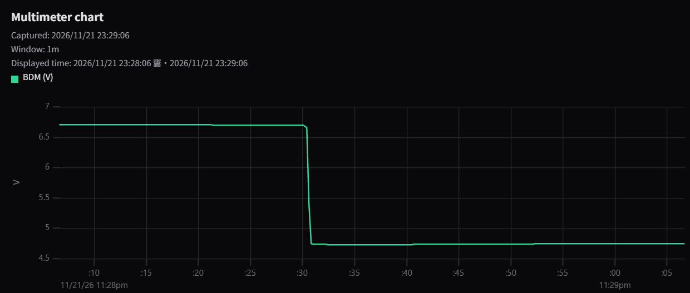
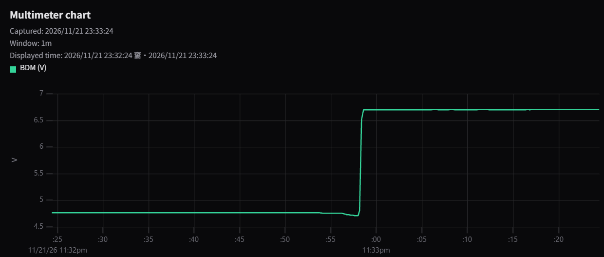
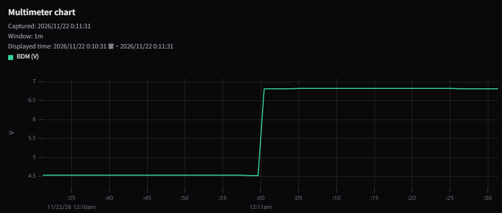
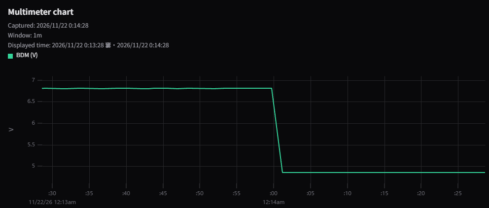
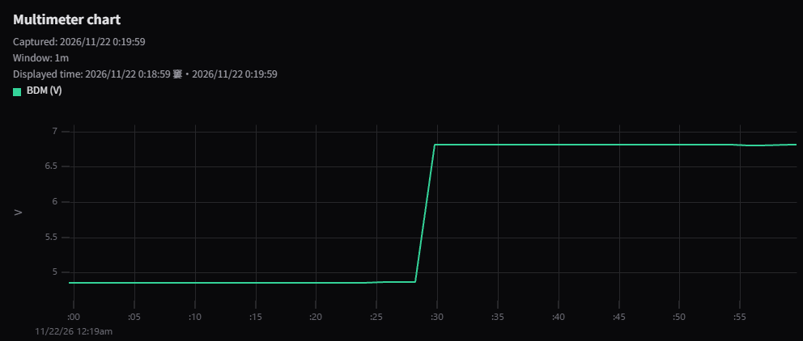

# M43B-8 C/D 実機検証記録 — 通信分離・切断・FIFO欠落ガード

- 文書種別：実測結果・故障注入の検証報告（製品の総合認定ではない）
- 対象日：2026-11-21～2026-11-22（JST）
- 対象基板：WeActStudio CH32X035 CoreBoard V1.0 / CH32X035F8U6
- MCU UUID：`c0-08-ab-cd-28-31-bc-5c`
- 試験版：`43b8c_disconnect_contract_guard`、`43b8d_g01_fifo_injection`
- 判定：**C01～C05の対象範囲、C04-B5/B6、C04-B7-P1/P2/P3 はPASS**（下記制約あり）
- 製品正式マイルストーン：M5（PC制御）とM7（安定性・保護）は引き続き進行中

## 1. 試験の目的と結論

USB PD/PPSとPC USB CDCを独立した経路で同時利用し、PD電源またはPC USBの接続状態が変化しても、契約状態とMCU電源を区別して検証した。さらに、実験DではPD PHYイベントFIFOを**意図的に満杯**にし、DETACHイベントの登録が失敗する状況で、C由来の物理CCガードが契約を失効させることを実機で確認した。

**確認できたこと**：7V/要求上限1AのPPS契約、約5秒周期更新、PC USB切断中の継続動作、通常CC DETACHの契約失効、MCUを動作させたままの再契約、決定的FIFO欠落注入時の契約失効、その後の再契約と故障注入履歴保持。

**確認していないこと**：実負荷で1Aが流れたこと、Source/CC向き/ケーブル全組み合わせ、自然発生する割り込み競合の完全再現、長時間・高負荷・全USB PD規格適合、3V3の連続DMM波形、保護回路の製品認定。

## 2. 実験接続・安全上の前提

- **PD入力**：USB-C PD充電器のVBUS/GND/有効なCC経路をWeActへ。PD側D+/D−はPCデータ線から隔離。
- **PC USB CDC**：PC側D+/D−をWeActへ、PC側VBUSはWeAct VBUSから隔離。PC側USB-CレセプタクルのCC1/CC2は各々独立した約5.1kΩ RdでGNDへ。GNDは共通。
- **CC1/CC2は直結しない**。PD側で使用中のCC選択配線を維持し、通電中に切り替えない。過去の誤ったCC短絡図は使用しない。
- **C04-B系バックアップ給電**：PD VBUSとWCH-LinkE 5Vのそれぞれに1N5819（アノード供給側、カソードの帯印をWeAct側）を直列に入れ、カソードをWeAct VBUS側で合流させる。GND共通。LinkE 3V3ピンはWeActへ接続しない。
- **計測時の外部負荷はなし**。WCH-LinkE 5Vの供給能力に依存する実験配線であり、一般の製品向け回路として検証したものではない。
- C04-B1：1N5819の方向・導通検査 **PASS**。C04-B2：OR回路の無通電導通・絶縁検査 **PASS**。C04-B3：LinkE 5V単独でWeAct VBUS **4.8V、PASS**。C04-B4：PD+バックアップ併用でVBUS **6.7V、PASS**。

## 3. M43B-8 C：接続・切断・復旧試験

| ID | 試験条件・観測値 | 判定 |
|---|---|---|
| C01 | PC CDCとPD/PPS 7000mV/1000mA契約。VBUS約6.96V、3V3約3.297V、約5秒周期更新 | PASS |
| C02 | COM16 Close約20秒後に再Open。`ref_done`+4、`elapsed`+20,441ms、契約維持 | PASS |
| C03 | PC USBを物理切断して再接続。`ref_done`+10、`elapsed`+54,295ms、PDERR重要項目0、VBUS約7V維持 | PASS |
| C04-A | PD電源切断でWeAct VBUS/3V3が約0V、COM16消失。PC側からの逆給電なし | PASS |
| C05-A | PD電源再投入でVBUS約6.96V、3V3約3.297V、COM16再認識 | PASS |
| C05-B | 16秒間のCDCログで`ref_done`2074→2077（+3）、`elapsed`+16,076ms、PDERR全0 | PASS |
| C04-B5 | **バックアップ5V維持のまま通常CC DETACH**。VBUS約6.7→4.72V、`STAT a/pe/pps`=0/0/0、`applied=0`、`PDSTOP detach=1`、`vbus_loss=0`、`COUNT rst`2→2。切断後観測間`ref_done`106→106 | PASS |
| C04-B6 | **MCU電源を維持したままPD再接続**。VBUS約4.75→6.70V、7V/1A PPS再契約、16秒間`ref_done`0→3、`COUNT rst`2→2、PDERR重要項目0 | PASS |

C04-B5での`trace_drop=1168`はPHY診断トレースの欠落であり、イベントFIFOの`event_lost`（0）とは別。切断時に統計へ反映されるため、その瞬間に1168件が発生したとの解釈はしない。C04-B6では新セッションで`trace_drop=0`。

### C版の識別情報

- M43B-8 C復旧用BIN：`src/pd_pps/firmware/experiments/43b8c_disconnect_contract_guard/m43b8c_disconnect_contract_guard.bin`
- サイズ：**26,160B**
- SHA-256：`38D0B7D2B81A8485D4F366325EE62298EF003B1CBDAE66506059525DA2DE6658`
- M43B-8 Cによる一連の通常切断試験後、故障注入専用D版へ明示許可を得てFlashした。Cのファイル自体は変更しない方針で作業した。

### 通常CC DETACH／再接続のDMMグラフ




## 4. M43B-8 D：ソース・ビルド・Flash検証

- 実験フォルダー：`src/pd_pps/firmware/experiments/43b8d_g01_fifo_injection`
- M43B-8 Cから独立した故障注入専用版。`G01 STATUS`／`G01 ARM`／`G01 CANCEL`を追加。ARM後30秒以内の次回の物理CC DETACHに対して1回限りの注入を行う。通常動作時は非ARM。
- プロジェクト固有マクロ：`M43B8D_G01_BENCH=1`。
- WindowsのxPack GCCクロスビルド結果：FLASH **27,000B/62KB（42.53%）**、RAM **5,924B/20KB（28.93%）**、正常終了。Cに対しFLASH+840B、RAM+16B。
- BIN SHA-256：`B444A9EBE105E051B0FD35582665BA297F6B3A9FD3EF520184532851943CE254`。
- ELF：65,332B、SHA-256：`E5E7533F9D2C9F0535995D9C398C02D4D1ECBB6535AF36C4A7D24332364DF8D2`。
- WCH-LinkE version **2.18**。Flash前後のProbeで`Detected CH32X035`、UUID一致、保護無効。明示的な保護解除`-p`なし。
- Flashの**27,000B読み戻しSHA-256がBINと完全一致**。`M43B8D_FLASH_VERIFIED_PASS`、`minichlink -b`正常終了。
- CDC初期動作：`PING`→`PONG M43A`（互換応答）、`STAT a=0`、`G01 armed/expired/fired/full/dropped/guard`がすべて0。COM16応答確認、`M43B8D_CDC_G01_SMOKE_PASS`。
- 試験用D版のBINは製品運用版とみなさない。Git管理するドキュメントの更新はFlashやファームウェア再ビルドを意味しない。

## 5. C04-B7：G01故障注入・復帰試験

| ID | 条件・観測値 | 判定 |
|---|---|---|
| P1 | 非ARMの通常7V/1A PPS。20秒間`ref_done`0→4、G01全0、PDERR全0、`COUNT rst`2→2。VBUS約6.8Vで安定 | PASS |
| P2 | `G01 ARM ok=1`から約7秒以内に物理PD切断。FIFO実効容量11を埋め、DETACH登録に失敗。`fired=1 full=1 dropped=1 guard=1 inserted=11 pre=0 lost_delta=1`、`PDERR event_lost=1`。旧契約失効、`PDSTOP detach=1`。VBUS約6.8→4.84V、`COUNT rst`2→2。切断後の`ref_done`36→36 | **PASS** |
| P3 | P2直後の状態からMCUを再起動せずPD再接続。VBUS約4.85→6.82V、7V/1A新契約、約20秒間`ref_done`0→4、USBリセットカウンター2→2、G01故障注入記録を維持 | **PASS** |

### P2：決定的なG01判定根拠

`G01 STATUS`（2026-11-22 00:14:05および00:14:23 JST）：

```text
G01 armed=0 expired=0 fired=1 full=1 dropped=1 guard=1 inserted=11 pre=0 lost_delta=1 fire_ms=421040
```

同時に`STAT a=0 pe=0 pps=0 mv=0 ma=0`、`PPS STATUS applied=0 active_mv=0`、`PDSTOP detach=1`、`PDERR event_lost=1 vbus_loss=0 faults=0`。`trace_drop=328`は別系統の診断トレース欠落であり、G01 FIFOの損失証明には使わない。切断前から最初の切断後サンプルまでの`ref_done`35→36の増加は切断前更新を含み得るため、**切断後2秒と20秒の両サンプルが36で不変**であることを停止判定に用いる。

### P3：復帰と履歴保持

再接続後の新セッションでは`PDSTAB caps=1 req=1 pps=1`、`STAT a=1 pe=4 pps=1`、`PPS STATUS applied=1 active_mv=7000 active_ma=1000`。20秒後には`req=5 ref_start=4 ref_done=4`。G01の`fired/full/dropped/guard=1`、`inserted=11 pre=0 lost_delta=1 fire_ms=421040`を維持。`PDERR event_lost`は新セッションで**1→0**に戻ったため、過去の注入の証跡としては保持されたG01専用診断値を優先する。

### DMMグラフ





## 6. 元ログと検証証跡（ローカル保管、Gitには含めない）

| 内容 | Windowsローカルの相対パス（基点：`C:\pj\pd_pps`） |
|---|---|
| C04-B5 | `diagnostics/m43b8c_tests/runs/C04B5_20261121_232820_34062e42.log` |
| C04-B6 | `diagnostics/m43b8c_tests/runs/C04B6_20261121_233249_fc760dcb.log` |
| Dビルド | `diagnostics/m43b8d_g01/builds/20261121_234908_88ee98a3/build_transcript.txt` |
| D Flash/読み戻し | `diagnostics/m43b8d_g01/flash/20261122_000646_d636633a/` |
| D CDC smoke | `diagnostics/m43b8d_g01/runs/C04B7_SMOKE_20261122_000852.log` |
| C04-B7-P1 | `diagnostics/m43b8d_g01/runs/C04B7_P1_20261122_001104_4de3477b.log` |
| C04-B7-P2 | `diagnostics/m43b8d_g01/runs/20261122_001347_0ca3a4a2/C04B7.log` |
| C04-B7-P3 | `diagnostics/m43b8d_g01/runs/C04B7_P3_20261122_001923_ab36df2d.log` |

上記のログパスと結果は会話で提示された実行出力による。実ログファイルそのもののハッシュは未取得であり、Gitへ取り込んでいない。DMM画像5点はユーザーから提示されたグラフをこの文書の証跡として複製した。グラフの表示時刻と操作者のEnter入力時刻は完全には一致せず、物理的接続操作がEnterより先行する。

## 7. 判定の範囲・残課題

1. C版の通常CC DETACHとD版の**決定的なFIFO欠落注入**に対するガードは、今回の実機・無負荷・指定配線条件でPASS。FIFOは11件の注入により満杯となり、DETACH登録失敗と物理CCガード作動を専用診断値で確認した。
2. **自然発生する11イベントのIRQ集中、すべてのレース、異種PD Source、全CC向き、実負荷は未検証**。Dの注入が実際のソース環境で起こる全過負荷を代表するとは限らない。
3. `COUNT rst`が不変でCDCが継続応答することはMCU継続動作を強く支持するが、独立したMCUリセット原因レジスタ記録と3V3連続波形は未取得。
4. 7000mV/1000mAは**要求した契約値**。1Aの実電流と独立したハードウェア電流制限を証明しない。
5. `trace_drop`と`event_lost`を区別する。P2後`event_lost=1`は新PDセッションで0に戻るため、保持されるG01専用診断値を併記する。
6. D版は故障注入が有効化できる**ベンチ専用ビルド**。通常運用に展開する前にC版への復帰または故障注入機能を除いた別版の適切な検証が必要。いずれのFlashも本記録の作成だけでは許可しない。
7. M5/M7の正式ゲートは未完了。今回のPASSを全製品安全性の合格に拡大解釈しない。
